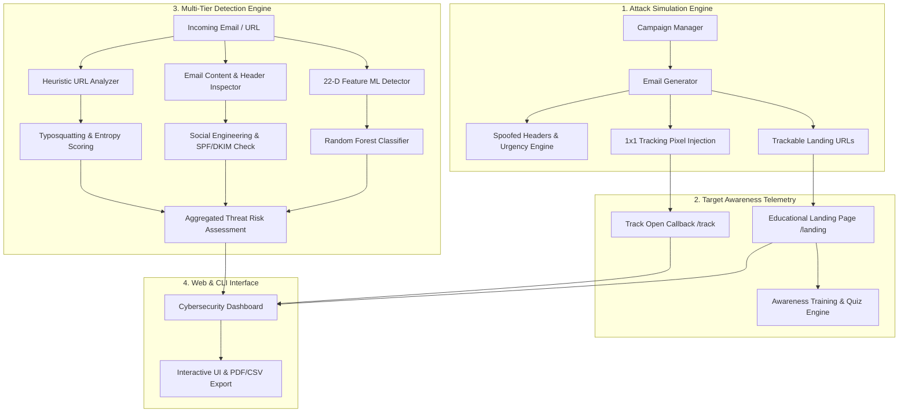

# 🛡️ PhishGuard: Phishing Attack Simulation & Detection Framework

> **Internship Project:** Phishing Attack Simulation and Detection  
> **Author:** Antigravity AI & Cybersecurity Engineering Intern  
> **Environment:** Python 3.10+, Flask, Scikit-Learn, Pytest, Bootstrap 5  
> **License:** MIT License  
> **Disclaimer:** *This framework is engineered strictly for educational, defensive research, and authorized organizational awareness testing purposes. Unauthorized phishing attacks are illegal and unethical.*

---

## 📋 Executive Summary & Project Objectives

Phishing remains the number one initial attack vector in cyber attacks globally, accounting for over **85% of initial network breaches** (Verizon DBIR). The goal of this internship project is to build an end-to-end simulation and defensive detection suite that allows security teams to:

1. **Simulate Phishing Attacks Safely:** Assess organizational human vulnerability across multiple templates (Password Reset, Fake Invoice, Account Verification, CEO/BEC Fraud, IT Patches).
2. **Implement Multi-Layer Detection Engines:**
   - **Heuristic URL & Website Analyzer:** Typosquatting, IDN homoglyphs, IP hostings, domain Shannon entropy, and credential form analysis.
   - **NLP & Social Engineering Filter:** Identification of urgency, fear, authority, and scarcity manipulation tactics.
   - **Machine Learning Classification:** 22-dimensional feature extraction with a Random Forest classifier.
3. **Enhance Security Awareness:** Interactive educational landing pages, interactive quizzes across difficulty tiers, and automated vulnerability reports.

---

## 🏛️ System Architecture



---

## 🧩 Core Modules & Features

| Module | File | Key Capabilities |
| :--- | :--- | :--- |
| **Email Generator** | `email_generator.py` | Generates 8 realistic phishing templates, urgency modifiers, spoofed headers, and tracking elements. |
| **Campaign Manager** | `campaign_manager.py` | SQLite persistence, target tracking, interaction logging (sent, opened, clicked, submitted, reported). |
| **URL Analyzer** | `url_analyzer.py` | Typosquatting, Levenshtein edit distance, homoglyphs, IP detection, shorteners, and Shannon entropy. |
| **Website Analyzer** | `website_analyzer.py` | Inspects DOM login forms, hidden credentials fields, favicon origins, and brand title discrepancies. |
| **Email Analyzer** | `email_analyzer.py` | Analyzes urgency/fear keywords, Cialdini's 6 social engineering principles, SPF/DKIM verification. |
| **ML Phishing Detector** | `ml_detector.py` | 22-dimensional feature extraction, Scikit-Learn Random Forest model with weighted rule-based fallback. |
| **Awareness Trainer** | `awareness_trainer.py` | 30 curated questions across 3 difficulty tiers (Beginner, Intermediate, Advanced) with instant explanations. |
| **Web Dashboard** | `dashboard.py` | Dark cybersecurity UI (Flask + Bootstrap 5 + Chart.js) with real-time analytics. |
| **CLI Application** | `main.py` | Full-featured command line suite supporting scanning, campaign orchestration, model training, and demo. |

---

## 🚀 Installation & Quickstart

### 1. Prerequisites
- Python 3.10 or higher
- PowerShell, Bash, or Command Prompt

### 2. Setup Virtual Environment & Install Dependencies
```bash
# Clone or navigate to the project directory
cd C:\Users\Hp\.gemini\antigravity\scratch\phishing-attack-simulation

# Create virtual environment (optional but recommended)
python -m venv venv
.\venv\Scripts\activate   # On Windows
# source venv/bin/activate # On Linux/macOS

# Install dependencies
pip install -r requirements.txt
```

---

## 💻 CLI Usage Guide

The unified CLI provides instant terminal access to all simulation and detection tools:

### Run Full End-to-End System Demo
```bash
python main.py demo
```

### Launch Web Dashboard
```bash
python main.py dashboard --port 5000
# Open your browser to http://127.0.0.1:5000
```

### Analyze a Suspicious URL
```bash
python main.py analyze-url "http://g00gle.com.account-update.tk/login"
python main.py analyze-url "http://192.168.1.100/secure-login/paypal/verify.php"
```

### Analyze Email for Phishing & Social Engineering
```bash
python main.py analyze-email \
  --sender "security@paypa1-update.tk" \
  --subject "URGENT: Your account has been suspended!" \
  --body "Unusual activity detected. Click http://192.168.1.1/login within 2 hours or your credentials will be revoked."
```

### Train and Evaluate ML Detector
```bash
python main.py train-model
```

### Interactive Terminal Awareness Quiz
```bash
python main.py quiz --difficulty intermediate --count 5
```

---

## 🧪 Running Unit Tests

PhishGuard contains an extensive Pytest test suite covering all analyzers and models:
```bash
pytest -v tests/
```

---

## 🛡️ Security & Ethical Guidelines

> **IMPORTANT:**
> 1. Always obtain explicit, written authorization before running phishing simulations on any organization or individuals.
> 2. PhishGuard generates safe placeholder links (`/landing`) that route targets directly to educational awareness landing pages explaining what indicators were missed.
> 3. Never collect, log, or store plaintext passwords or sensitive financial credentials in simulation environments.
> 4. The goal of simulations is to **educate and empower users**, not to trick or penalize employees.

---

## 🎓 Skills Learned in this Internship Project

- **Adversarial Phishing Techniques:** Anatomy of spoofed headers, display name spoofing, urgency/fear psychological manipulation, homoglyph substitution, and typosquatting.
- **Email Security Protocols:** How SPF, DKIM, and DMARC authenticate message origin and protect against header spoofing.
- **Defensive Heuristic Analysis:** Levenshtein string distance calculations, domain entropy algorithms (Shannon entropy for DGA detection), and URL structure anomaly detection.
- **Machine Learning for Threat Detection:** Feature engineering from raw unstructured text, 22-dimensional feature space vectorization, Random Forest training, and precision/recall evaluation.
- **Full-Stack Cybersecurity Engineering:** Building interactive, dark-themed SOC dashboards with Flask, Chart.js, SQLite, and RESTful endpoints.
